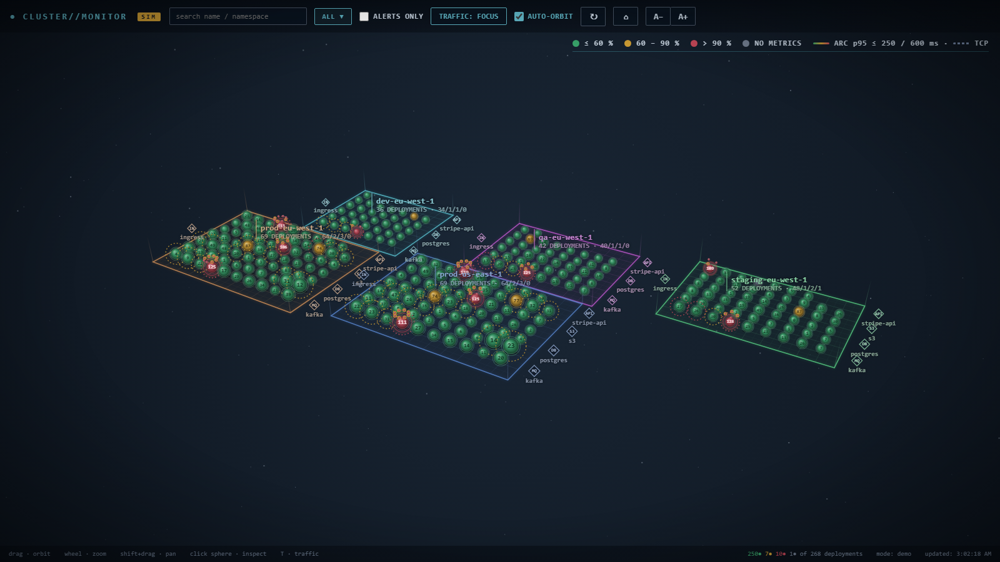

# Cluster Monitor

A 3D, multi-cluster Kubernetes dashboard. Every cluster is a plane, every deployment a sphere
coloured by CPU usage, and service-mesh traffic is drawn as arcs between them — so you can see
at a glance which workloads are hot, which are failing, and who is calling whom.



## Features

- **Multi-cluster view** — one plane per kubeconfig context (built for EKS; works with any cluster).
- **Deployment spheres** — CPU % shown on each sphere, coloured green / amber / red
  against configurable thresholds (`≤ 60 %`, `60–90 %`, `> 90 %` by default), measured
  against container requests or limits.
- **Pod launch** — click a red deployment and its pods lift onto a tethered plane above it;
  click a pod for CPU, memory, restarts, phase, node and a per-container breakdown
  (including sidecars).
- **Mesh traffic** (demo only for now) — Kuma-style arcs between deployments and to externals
  (ingress, Postgres, Kafka, S3, third-party APIs). Arc width = requests/s, colour = p95 latency
  and 5xx rate. Toggle focus / problems / all / off with `T`.
- **Search & filters** — by name or namespace, "alerts only", per-cluster selection.
- **Read-only** — the collector only lists nodes, deployments and pods and reads the
  metrics API; it never writes to the cluster.

## Quick start (demo mode)

No cluster needed — demo mode simulates five clusters with realistic load.

```bash
python -m venv .venv
.venv/Scripts/activate          # Windows; use `source .venv/bin/activate` on Linux/macOS
pip install -r requirements.txt
python main.py --demo
```

Open <http://localhost:8081>.

> `main.py` binds to `0.0.0.0`. On a shared network, put it behind a firewall or reverse proxy.

## Running against real clusters

```bash
python main.py --kubeconfig ~/.kube/config --clusters ctx-a,ctx-b --namespaces team-x,team-y
```

Requirements:

- A kubeconfig whose contexts can `get`/`list` nodes, deployments and pods.
- [metrics-server](https://github.com/kubernetes-sigs/metrics-server) (or another metrics API
  provider) for CPU/memory; deployments without metrics show as grey.
- For EKS, the AWS CLI exec plugin must work in the same shell (`aws eks get-token`).

## Configuration

Every option can be set as a CLI flag or an environment variable.

| Flag | Env var | Default | Meaning |
|---|---|---|---|
| `--demo` | `DEMO_MODE` | off | Use simulated data |
| `--kubeconfig` | `KUBECONFIG` | — | Path to kubeconfig |
| `--clusters` | `CLUSTERS` | all | Comma-separated context names |
| `--namespaces` | `NAMESPACES` | all | Comma-separated namespace allow-list |
| `--cpu-basis` | `CPU_BASIS` | `requests` | `requests` or `limits` |
| `--refresh` | `REFRESH_SECONDS` | `15` | Poll interval (s) |
| `--amber` / `--red` | `AMBER_THRESHOLD` / `RED_THRESHOLD` | `60` / `90` | CPU % thresholds |
| `--lat-amber` / `--lat-red` | `LATENCY_AMBER_MS` / `LATENCY_RED_MS` | `250` / `600` | p95 latency thresholds (ms) |
| `--err-amber` / `--err-red` | `ERROR_AMBER_PCT` / `ERROR_RED_PCT` | `0.5` / `2` | 5xx share thresholds (%) |
| `--port` | `PORT` | `8081` | HTTP port |

## Controls

| Input | Action |
|---|---|
| Drag | Orbit |
| Wheel | Zoom |
| Shift + drag | Pan |
| Click sphere | Inspect deployment / launch pods |
| `T` | Cycle traffic view |
| `A-` / `A+` | Text size |

## Project layout

```
main.py                 CLI entry point
monitor/
  config.py             Settings (CLI + env)
  k8s.py                Read-only Kubernetes collector
  demo.py               Simulated clusters, deployments, pods
  demo_traffic.py       Simulated Kuma mesh traffic
  model.py              Snapshot dataclasses + classification
  web.py                FastAPI app (JSON API + static UI)
  static/               Canvas 2D front end (no build step)
tests/                  pytest suite
```

## Tests

```bash
python -m pytest -q
```

## Roadmap

- Real Kuma / Prometheus collector for the mesh-traffic view (currently demo only).

## License

MIT, see [LICENSE](LICENSE).
